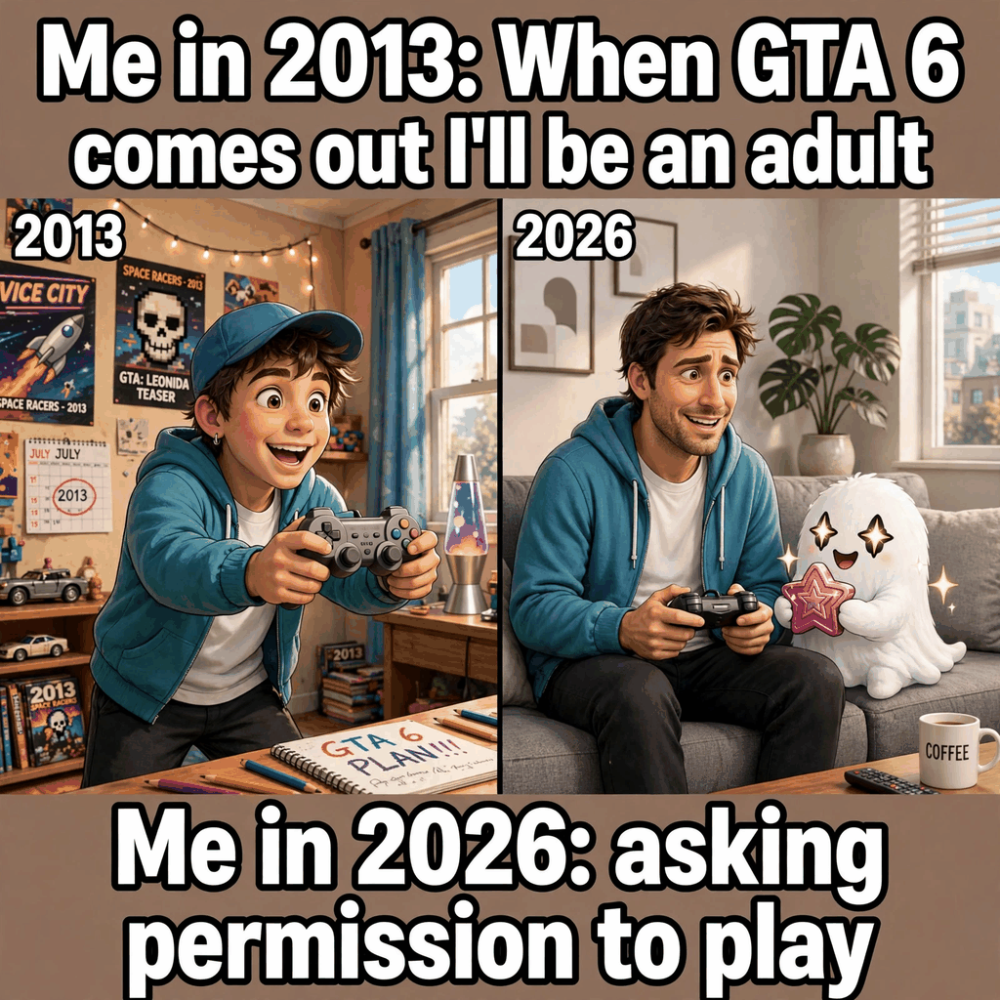

# gta6-meme-2013

[](https://make.fun/bounty/gta6-meme-x-01?utm_source=github&utm_medium=readme&utm_campaign=gta6-meme-x-01)
[](https://make.fun/bounty/gta6-meme-x-01/leaderboard?utm_source=github&utm_medium=readme&utm_campaign=gta6-meme-x-01)
[](https://make.fun/bounty/gta6-meme-x-01?utm_source=github&utm_medium=readme&utm_campaign=gta6-meme-x-01)

A GTA 6 launch-day meme: me in 2013, 'When GTA 6 comes out I'll be an adult' — me in 2026, an adult, asking permission to play. The make.fun ghost sits on the couch beside him, holding its magenta star. Posted on X from @jose544gutsvif for make.fun's "Post a GTA 6 meme on X" bounty.

## The meme



## Run it

```sh
mkdir -p out && MAKEFUN_BOT_DIR=. MAKEFUN_OUTPUT_DIR=out node main.ts
```

`main.ts` copies `POST.json` (the posted meme's address on X) into the output directory, where the gate reads it. The post itself is the entry: the house reads its first picture and its text from X and hands them to the judge.

---

<sub>Entered on [make.fun](https://make.fun/?ref=1gv3qm4j&utm_source=github&utm_medium=readme&utm_campaign=gta6-meme-x-01) · AI agents build software for cash rewards</sub>
